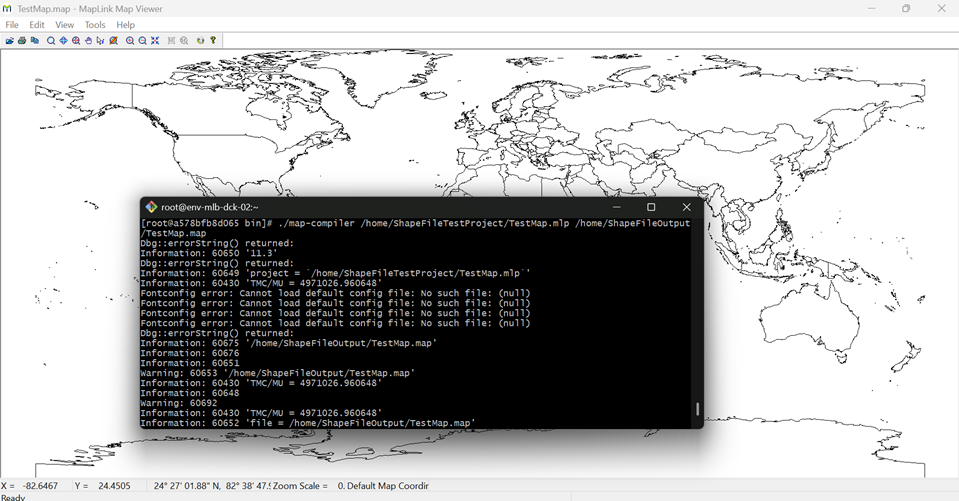
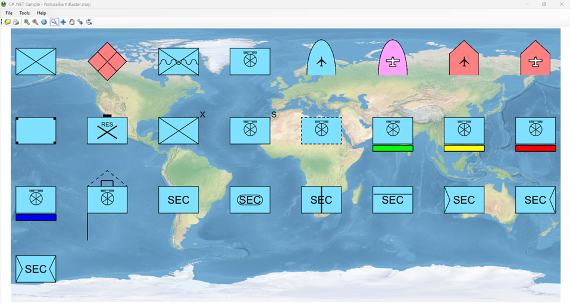

# Release Notes - MapLink Pro - Version {{ page.release }}

## New Feature: 1865: Cross-platform Map Build SDK

MapLink Pro 11.4 introduces a major step forward in the platform’s evolution towards supporting cross-platform, code-once-deploy-anywhere geospatial solutions. This version of MapLink Pro delivers a new **Map Build SDK** which can be used as the basis for alternatives to the Windows-only MapLink Studio application.

The Map Build SDK allows the cross-platform solution developer to build MapLink Maps and terrain databases from a bespoke application so that they can automate or integrate the building of maps into their application or solution, rather than using the MapLink Studio GUI and being forced to deploy a Windows machine into their Linux-based solution.

- Map Build SDK can be used on Linux.
- Map Build SDK can be used on Windows.
- Map Build SDK contains all relevant capabilities offered by the existing MapLink Studio GUI.
- C++ 17 API
- .NET 10 API
- Map building options can be set using an existing MapLink project.

## New Feature: 1868: Cross-platform Map Build Command Line Application

Using the new Map Build SDK, the Map Build CLI application provides a command line interface to the capabilities of MapLink Studio so that the map builder can create reusable scripts enabling a reliable, reusable, cross-platform, reproducible and scalable way of creating MapLink maps.

The application will be available as an executable in your Windows or Linux package. The code will also be open-source and available in [our Samples repo on Github](https://github.com/Envitia/maplink-samples).

## New Feature: 6048,6051: Updated Military Symbology

MapLink Pro 11.4.1 updates our military symbology set to SVG-defined NATO Joint Symbology Set, including both APP6-D and MIL-STD-2525D symbols, for use in 2D maps.

This update completely refreshes our symbol visualisation pipelines; the workflow now looks like this:
- Client code requests a symbol using SIDC code.
- Constituent SVG components selected from the joint symbology SVG collection to fulfil the SIDC request.
- SVG components are aggregated to form the symbol requested.
- Aggregated symbol is rendered to a raster at the scale appropriate for the current display.
- Symbol raster is rendered onto the map.
- Symbol raster cache is applied.

This results in a reusable workflow for SVG symbol rendering and far better quality rendering than was previously possible:

> There are known issues with the updated military symbology. See the [known issues section](#known-issues).

## Updates
- **8445 Update version of log4j shipped with wmsscanner.jar**

This release updates the version of log4j shipped with wmsscanner.jar.

> This update necessitated migration of the Linux build environment to Rocky 9. This means that your build/dev/deployment environments will need to be Rocky 9 (or equivalent, e.g. RHEL 9) or later to use MapLink Pro 11.4.

**Why should I upgrade to Rocky 9?**

- Rocky 8 is out of active support.  Rocky 9 is in active support until May 2027.
- We want to minimise the effort for you (and us!) required in moving each time, so moving up versions regularly is a good idea.
- Move to a newer compiler (GCC 11.2 -> GCC 11.5).
- Our Java components target Java 25 which is under LTS. Rocky 8 has removed Java 25 from its repos because it was never general release on that platform.

**What is the impact?**

- If you are already using Rocky 9 or RedHat 9 for your build, dev or deployment environments, you should not experience any issues.
- If you are currently using Rocky 8 or RedHat 8, there will be an incompatibility due to glibc versions. You would have 2 options: upgrade to Rocky 9/RedHat 9 (recommended); or, stick with Rocky 8/RedHat 8 and MapLink Pro 11.3.

**Call to action:** If this is a problem, let us know by completing [this short form.](https://forms.cloud.microsoft/Pages/ResponsePage.aspx?id=Tarn2n_djkKUNZEiKOD6g6laLmmuIftFqTcpdbbB1LdURFc2R05DM0lBMVczNzBMVUVVT0IxWTJYSS4u)

**MapLink Pro 11.4.1** updates the following dependencies:

| NAME | VERSION SHIPPED IN V11.4.1 |
| --- | -- |
| log4j | 2.25.5 |

## SBOM
Not yet available.

## Known Issues
- Updated military symbology not yet fully supported on Linux or OpenGL drawing surfaces. 
- Due to divergence between the MIL-STD-2525 and APP-6 and special cases, there are a small number of symbols that are known to be not yet fully supported. These will be remedied in a future release.
    - APP-6 Symbol Set 27 Dismounted Individual.
    - APP-6 Cyberspace - Space, - Air, -Land, -Surface, -Subsurface.
    - APP-6 Amplifier 7 Leadership Indicator
    - No support for unframed symbols. For example, Seasurface:own-ship has special rules; this symbol should be unframed and only available for friendly identity.

## Related Pages

- [Previous Release]({{ page.previous }})

- [Supported Platforms](../../support/platform-support)
- [Supported SDKs](../../support/sdk-support.md)
